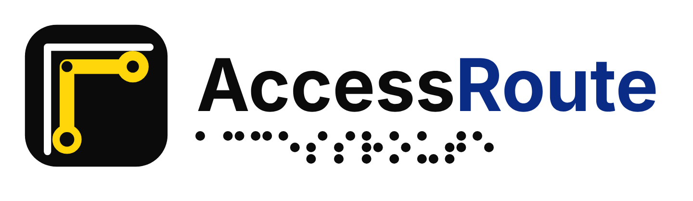
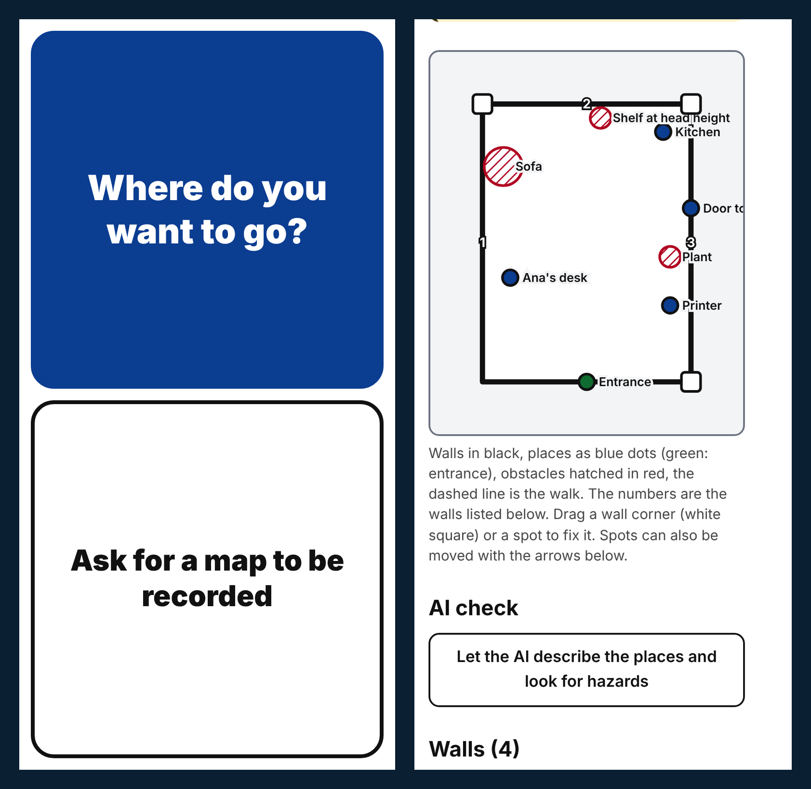
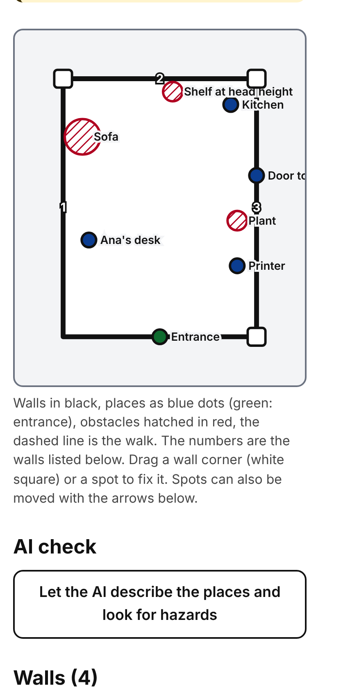
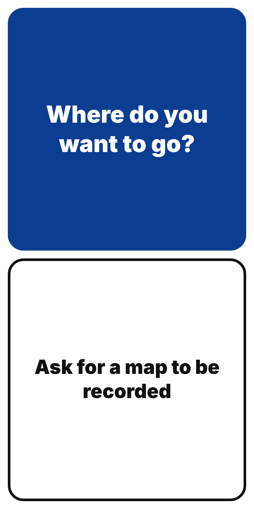
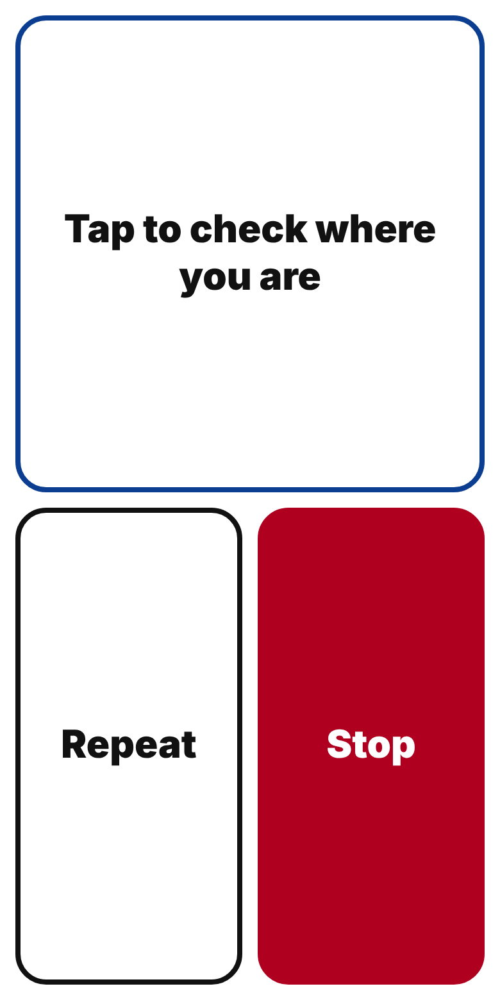
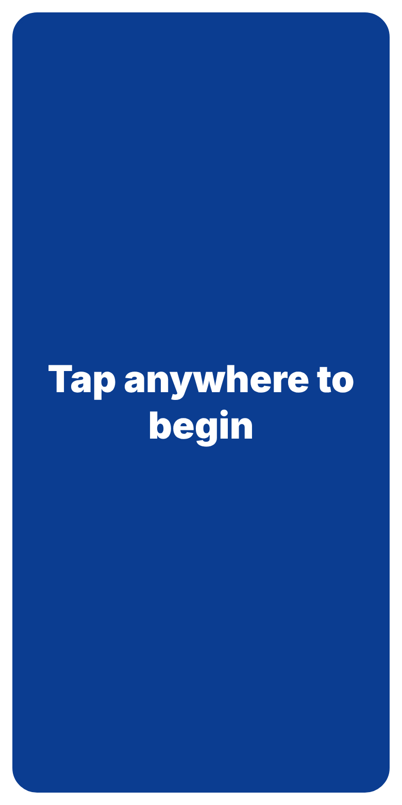
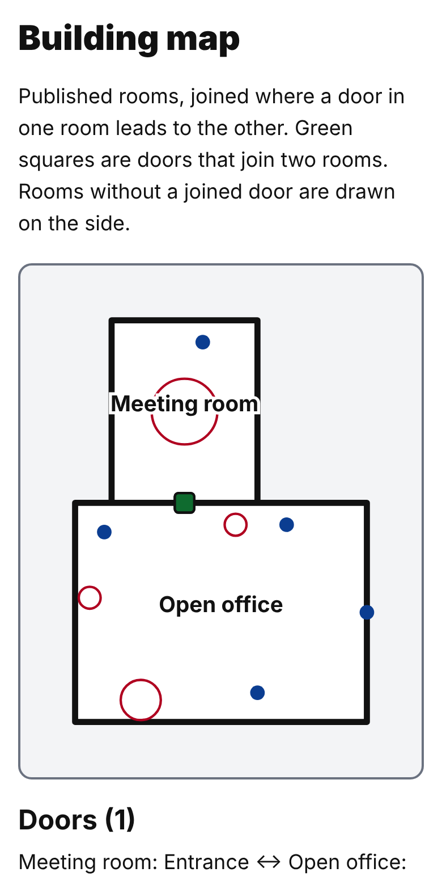
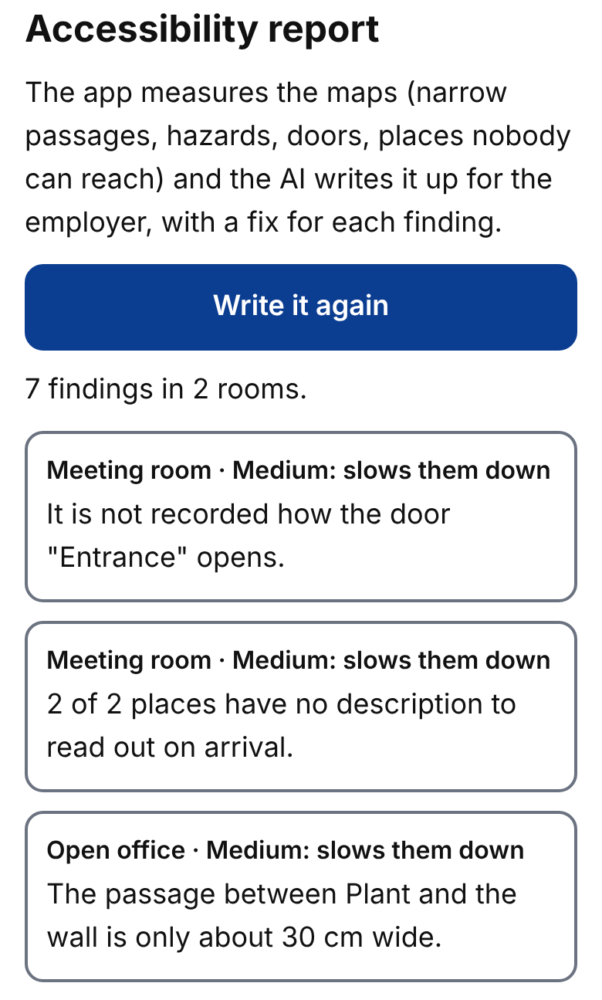
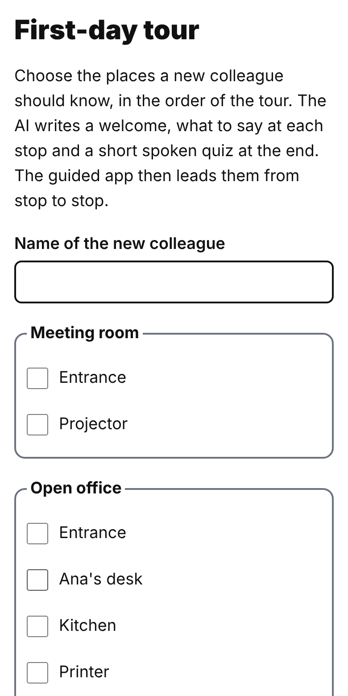

<h1 align="center">
  <picture>
    <source media="(prefers-color-scheme: dark)" srcset="docs/logo/accessroute-logo-dark.png">
    
  </picture>
</h1>

<p align="center"><strong>Your first day at a new job, without having to ask for directions.</strong></p>

AccessRoute guides blind and partially sighted employees around their office by voice. Colleagues map each room
once by walking it with a phone. After that, the new employee can ask "Where can I get coffee?" and is guided
there one instruction at a time: along the walls, from corner to corner, the way orientation and mobility
instructors teach it.

Built in 24 hours at the *First Job, Full Potential: AI for an Inclusive Start at Work* hackathon by Eduard,
Ghiduc and Marcelin.

<!-- SCREENSHOT: docs/screenshots/hero.png -->
<p align="center">
  
</p>

---

## The problem

More than 30 million blind and partially sighted people live in Europe, and over 75% of those of working age
are unemployed ([European Blind Union](https://euroblind.org/about-blindness-and-partial-sight/facts-and-figures)).
Getting the job is only the first step. On day one the building itself becomes the barrier:

- every route has to be learned from scratch: desk, kitchen, toilets, printer, meeting rooms;
- every trip means asking a colleague, so independence and confidence suffer from the start;
- orientation and mobility (O&M) training is hard to get and rarely happens at the new workplace.

The apps that exist today either describe what the camera sees, need a volunteer on a video call, or need beacons
or QR codes installed in the building. None of them teaches you the way around your own office.

## Who it is for

| User | What they do |
|------|--------------|
| **The new employee** (blind or partially sighted) | Asks where to go, is guided by voice, takes the first-day tour |
| **Colleagues** | Record a room in about a minute, check the map, mark doors and hazards |
| **HR / the employer** | Prepare a first-day tour, get an accessibility report of the office |

## How it works

### 1. A colleague walks the room once

Standing at the entrance, they press start and walk once along all the walls, pressing *Corner* in every corner.
The phone counts steps from the rhythm of the walk, follows the turns with the gyroscope, squares the walls and
closes the loop. Then they point the camera at each place (a desk, the kitchen, a door) or obstacle (a sofa, a
plant), name it, and tap the drawing where it is.

<!-- SCREENSHOT: docs/screenshots/recording.png -->
<p align="center">
  
</p>

### 2. The map is checked before anyone relies on it

Every new map waits in *To check*. The reviewer sees the video and the room from above, can type the real wall
lengths (the room stays square), drag places into position and write a short description that is read out on
arrival. They also note what stands along each wall ("cupboards", "sofa"), which walls are glass, which way doors
open and which obstacles a cane will not find (head height, stairs, glass).

The AI looks at the recording too: it writes a description for every place and points out possible hazards.
Nothing it suggests is used until the reviewer accepts it.

<!-- SCREENSHOT: docs/screenshots/review.png and docs/screenshots/ai-check.png -->
<p align="center">
  
  
</p>

### 3. The employee is guided by voice

The guided screen has nothing to read: the top half and the bottom half are the only buttons, in the same places on
every screen. The person taps the top half and says where they want to go, or asks something like "Where can I get
coffee?".

Routes follow the walls, so the cane always has something to trail:

> *"Keep the wall on your left until you reach the corner, about 9 steps."*
> *"The wall is blocked by a cupboard, step around it on your right, then find the wall again."*
> *"Careful, a glass door ahead. It opens towards you, pull it."*
> *"You have arrived at the kitchen. The coffee machine is to the right of the sink."*

Corners and doors are checkpoints: the person taps when they feel them, and the position starts again from a point
the map knows exactly, so step-counting errors never add up. A soft tick sounds for every counted step, and the
last three are counted down. Places in other rooms (or on other floors, by lift or stairs) are reached through the
joined doors, room after room.

<!-- SCREENSHOT: docs/screenshots/guide-home.png, docs/screenshots/guiding.png, docs/screenshots/tutorial.png -->
<p align="center">
  
  
  
</p>

### 4. For the whole team

- **Building map**: rooms joined by their doors, drawn side by side.
- **Temporary obstacles**: a wet floor or boxes in the way are added in seconds. Routes go around them until they
  expire.
- **Report a problem**: a place that is out of order is skipped by guidance.
- **First-day tour**: HR picks the stops, AccessRoute writes a personal welcome and what to say at each stop, guides
  the new colleague from stop to stop, then asks a short spoken quiz.
- **Accessibility report**: narrow passages, hazards, unmarked doors and places nobody can reach, written up for the
  employer with a fix for each.

<!-- SCREENSHOT: docs/screenshots/building-map.png, docs/screenshots/report.png, docs/screenshots/tour.png -->
<p align="center">
  
  
  
</p>

---

## Where AI is used (and where it is not)

| Feature | What the AI does |
|---------|------------------|
| Room check | Describes each place from its photo, finds hazards a cane misses |
| Instructor's voice | Rewords route instructions the way an O&M instructor would say them |
| Voice assistant | Understands needs ("I need the toilet", "where can I get coffee") and starts the route |
| What is in front of me | Describes the camera view: things that need care first, then objects and signs |
| First-day tour | Writes the welcome, the text for each stop and the quiz, and judges spoken answers |
| Accessibility report | Turns the measured facts into a report with priorities and fixes |

The AI never decides where someone walks:

- **Routes are computed** from the map geometry, not generated.
- **Wording is checked in code**: if a reworded instruction changes a number, a left or right, a turn or a warning,
  it is thrown away and the plain sentence is used.
- **A person confirms** every hazard and description before it counts.
- **"What is in front of me" only describes.** It never says a way is clear, and never describes people.
- Every AI call is logged in the server console with what it did and what it cost (`[ai] ...`). Checking a room
  costs about 2 cents, a question less than 1 cent.

Without an API key everything except these AI features still works.

## Accessibility

- **Blind and low vision**: no reading needed, everything is spoken and also sent to screen readers (ARIA live
  region), big high-contrast buttons, tones and a short vibration on every tap.
- **Motor**: half-screen tap targets, no fine gestures; the staff screens work with the keyboard alone.
- **Cognitive**: one instruction at a time, *Repeat* at any moment, a spoken tutorial the first time (saying "help"
  plays it again), step countdown, a guided first-day tour.
- **Personal**: the step length is calibrated from the person's height and ten counted steps.
- **Mobility**: the report flags passages under 90 cm, too narrow for a wheelchair.

## Privacy

- No accounts. No health or disability data is asked for or stored. The phone keeps only the role, the step
  calibration and whether the tutorial was done.
- Photos and maps stay on the employer's server. The API key stays on the server and is never sent to phones.
- Temporary obstacles expire on their own; their history is kept for one week.

## How we validated it

We based the guidance on established O&M techniques taught to blind people (trailing a wall with the cane,
landmarks, one step at a time) and tested every version blindfolded in real rooms, adjusting step counting,
corners, doors and wording after each run. A blindfold is not the same as living with a visual impairment, so the
first next step is a study with blind employees and an O&M instructor.

---

## Run it

Requirements: Node.js 20+.

```bash
npm install
cp .env.example .env.local    # add your ANTHROPIC_API_KEY (optional)
npm run dev                   # http://localhost:3000
```

Production build:

```bash
npm run build
npm start
```

Phones need HTTPS for the camera, microphone and motion sensors. For a quick test from a phone:

```bash
npx next start -p 3001
cloudflared tunnel --url http://localhost:3001
```

Open `/staff` on one phone to record a room and `/guide` on another to be guided.

```bash
npm test     # step detection, route planning, doors and building layout
npm run lint
```

### Environment

| Variable | Needed for |
|----------|------------|
| `ANTHROPIC_API_KEY` | The AI features. Without it the app still runs. |
| `BLOB_READ_WRITE_TOKEN` | Storing maps on Vercel Blob. Without it they are kept in `.data/` on disk. |

Never commit `.env.local`.

## Project structure

```
src/core/       shared code: map model and geometry, step detection, speech, storage, UI, AI client
src/modules/    recording · review · guidance · reports · assistant   (modules never import each other)
src/app/        pages and API routes that put the modules together
```

Built with Next.js, React, TypeScript, Tailwind, Zod and Vitest. The AI runs on Anthropic's Claude with
schema-validated structured output.

## What comes next

1. **Validate with users**: a study with blind employees and O&M instructors, through organisations of the blind.
2. **Audit**: WCAG 2.2 review, on-screen captions and vibration patterns for users who are deaf or hard of hearing.
3. **Positioning**: recognising where the person stands from image fingerprints, optional BLE/UWB beacons.
4. **Product**: native app, Romanian voice, offline mode, pilots with employers and integration with HR onboarding.
5. **More people**: step-free routes for wheelchair users and a simple-language mode.

## Team

- **Eduard Voicu** – [@edvt-exe](https://github.com/edvt-exe)
- **Ghiduc**
- **Marcelin**
